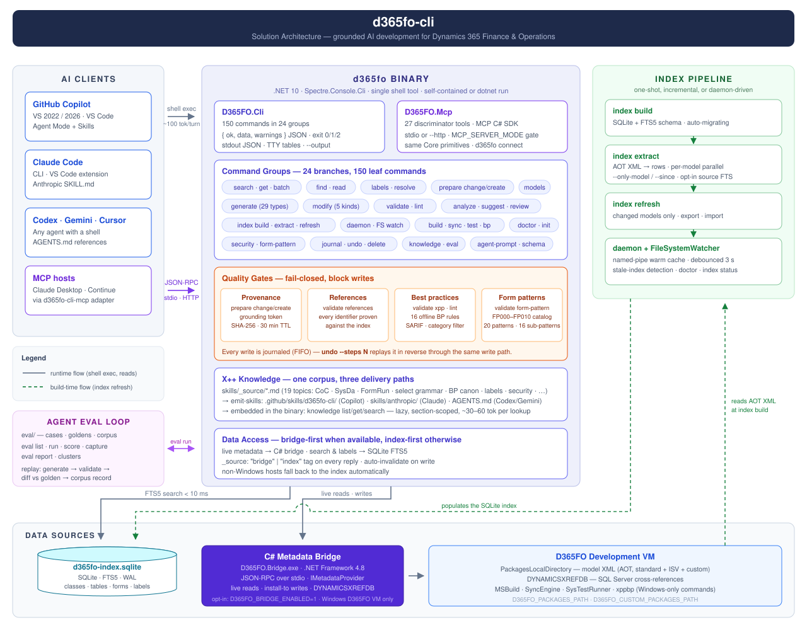
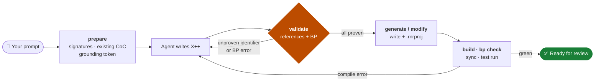
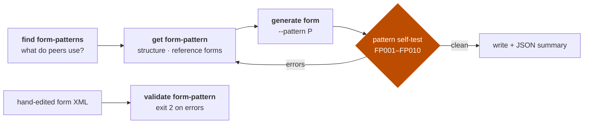
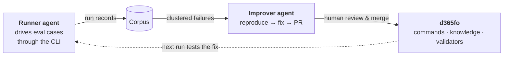

<div align="center">

# d365fo — D365 F&O CLI for AI agents

### Grounded AI development for Dynamics 365 Finance & Operations

**One command-line tool that knows every X++ class, table, form, EDT and label in *your* D365FO codebase —<br/>
so GitHub Copilot, Claude Code and any agent with a shell write X++ that compiles.**

[](https://www.npmjs.com/package/@dynamics365ninja/d365fo-cli)
[](LICENSE)
[](https://dotnet.microsoft.com/)
[](docs/SETUP.md)
[](docs/TESTING.md)
[](eval/COVERAGE.md)
[](https://github.com/dynamics365ninja/d365fo-mcp-server)

[**Quick start**](#-quick-start) ·
[**How it works**](#-how-it-works) ·
[**What to ask**](#-what-to-ask) ·
[**Commands**](#-commands) ·
[**Docs**](#-documentation) ·
[**Changelog**](CHANGELOG.md)

</div>

---

## 💡 Why

AI assistants are excellent at C#, Python and JavaScript. X++ is different: your D365FO codebase is
private, deeply customized and invisible to every model — so the AI confidently writes code against
methods, fields and labels that do not exist, and it does not compile.

`d365fo` pre-indexes your whole D365FO installation — hundreds of thousands of symbols across
standard, ISV and custom models — into a local SQLite index. Every signature, every existing CoC
wrapper, every label and every form pattern is checked against *your* metadata **before** the AI
writes a line, and a write that cannot be proven is refused. Because it is a shell command and not
an MCP tool list, it costs under 200 tokens of context per turn instead of thousands.

| | Without `d365fo` | With `d365fo` |
|---|---|---|
| **Method signatures** | Guessed → compile errors | `d365fo get class` — exact, from your codebase |
| **Existing CoC wrappers** | Manual AOT search | `d365fo find coc Class::method` in < 50 ms |
| **New forms** | Hand-written XML, broken patterns | Pattern-validated scaffolds; structural violations **block the write** |
| **Labels** | Hardcoded strings | The right existing `@SYS` / `@Module` label, found instantly |
| **Security chains** | Hours of manual tracing | Role → Duty → Privilege → Entry point in one call |
| **Generated code** | Hallucinated fields and types | Every reference proven against the index, gated before write |
| **Agent context cost** | 32 MCP tool schemas every turn (~13 600 tokens) | 1 shell tool + lazy-loaded skills (~170 tokens) |

---

## 🧭 How it works



1. **Index** — `d365fo index extract` reads your AOT metadata once into a SQLite database with
   full-text search. On a D365FO VM the **metadata bridge** adds reads and writes through
   Microsoft's own metadata provider, and cross-references come from `DYNAMICSXREFDB`.
2. **Ground** — before the agent writes anything, `prepare` hands it the real signatures, existing
   extensions, naming rules and a short-lived **grounding token** for the target object.
3. **Gate** — `validate references` proves every identifier and `validate xpp` checks the
   best-practice rules; forms are also checked against their pattern. Writes are **fail-closed**.
4. **Build** — the write is journalled (`undo` rolls it back), registered in your `.rnrproj`, and can
   be compiled, BP-checked, synced and tested from the same shell.

A typical change, end to end:



<details>
<summary><b>Form development pipeline</b> — patterns are rules, not suggestions</summary>

<br/>

Forms are the hardest artifact to generate correctly: each pattern dictates required containers,
their order and the allowed sub-patterns.



Structural violations (wrong order, missing container, disallowed control, misapplied sub-pattern)
**block the write** while `D365FO_FORM_PATTERN_ENFORCE=true` (the default); recommendations only warn.

</details>

---

## 🚀 Quick start

> [!IMPORTANT]
> From D365FO platform update **10.0.49 (PU74)**, **Visual Studio 2026** is the supported IDE for
> X++ development — Microsoft no longer supports VS 2022 there. Earlier platform versions still use
> VS 2022 ≥ 17.14. [Details](https://learn.microsoft.com/en-us/dynamics365/fin-ops-core/fin-ops/get-started/whats-new-platform-updates-10-0-49)

### 🖥️ Install on your D365FO VM — the usual case

With [Node.js](https://nodejs.org) 18 or later:

```powershell
npm install -g @dynamics365ninja/d365fo-cli
d365fo init                 # finds PackagesLocalDirectory and saves the configuration
d365fo index extract        # reads your metadata into the index (minutes, once)
d365fo doctor               # says what is still missing
d365fo skills install K:\repos\MySolution --for copilot     # or claude, all
```

The binaries are self-contained: no .NET SDK, nothing compiled on your machine. To let `d365fo`
write into your models, enable the bridge once and open a new shell:

```powershell
[Environment]::SetEnvironmentVariable('D365FO_BRIDGE_ENABLED', '1', 'User')
```

### ⬆️ Update

```powershell
d365fo update               # --check only looks, --to 0.3.0 picks a version
```

Your configuration and index live outside the package, so an update keeps them. Run
`d365fo skills install` again to bring the skills in your repository up to date.

### 🔌 Connect to a server your team already runs

For hosts that speak MCP, point the editor at a shared `d365fo-cli-mcp --http` instance:

```powershell
d365fo connect https://your-server.azurewebsites.net --editor vscode    # or claude
```

### ☁️ Deploy one shared server for the whole team

One App Service serves the index to every developer: [docs/SETUP_AZURE.md](docs/SETUP_AZURE.md).

> [!TIP]
> The full path — prerequisites, the agent skills and a one-minute check that grounding really
> works — is **[docs/QUICK_START.md](docs/QUICK_START.md)**.

<details>
<summary><b>Without npm</b> — release archive or build from source</summary>

<br/>

**Release archive:** download your platform from
[Releases](https://github.com/dynamics365ninja/d365fo-cli/releases), check it against `SHA256SUMS`,
extract it and put `bin` on `PATH`. Keep `D365FO.Bridge` beside `bin`.

**Installer** (clones the repository and builds it; needs the .NET 10 SDK, which it installs if missing):

```powershell
irm https://raw.githubusercontent.com/dynamics365ninja/d365fo-cli/main/install.ps1 | iex
```

```sh
# macOS / Linux
curl -fsSL https://raw.githubusercontent.com/dynamics365ninja/d365fo-cli/main/install.sh | bash
```

Set `D365FO_CLI_VERSION=v<version>` to install a particular release.

</details>

<details>
<summary><b>Windows, macOS or Linux?</b></summary>

<br/>

| | Search · read · scaffold · validate | `build` · `sync` · `test` · `bp` · bridge writes |
|---|:---:|:---:|
| Windows D365FO VM (classic or UDE) | ✅ | ✅ |
| macOS, Linux, CI | ✅ (index extracted from a share or imported) | ❌ `UNSUPPORTED_PLATFORM` |

On Windows, `d365fo` installed by npm is a command shim: an argument with `%VAR%` or a line break
does not survive `cmd.exe`. Call it from PowerShell or Git Bash, or pass such text through a file.

</details>

---

## 💬 What to ask

You never name commands — the skills teach the agent which to run. Ask the way you would ask a
colleague who knows the codebase:

| You ask | The agent runs |
|---|---|
| *"Add a CoC wrapper to `SalesLine.validateWrite` that blocks negative quantities"* | `prepare change` → exact signature and existing wrappers, `generate coc`, `validate references` |
| *"Create a table `ContosoRentEquipmentTable` with a SimpleList form and labels in en-US and cs"* | `prepare create`, `labels create`, `generate table`, `generate form` |
| *"Who has access to the `VendPaymTerms` form?"* | `security coverage` — Role → Duty → Privilege → Entry point |
| *"Is there a label for 'payment terms'?"* | `search label` across every label file and language |
| *"Where is `CustTable::find` called from?"* | `find references`, with `--xref` for compiler-resolved callers |
| *"Build the project, run BP and the tests"* | `build`, `bp check`, `test run` with structured diagnostics |

More whole tasks: [docs/USAGE_EXAMPLES.md](docs/USAGE_EXAMPLES.md).

---

## ✨ Capabilities

| | |
|---|---|
| 🔍 **Full-codebase intelligence** | Tables, classes, EDTs, enums, forms, queries, views, entities, reports, services, workflows, security artifacts and labels — results in milliseconds, no VM round-trip |
| 🛡️ **Grounded generation** | Fail-closed gates: `prepare` issues grounding tokens, `validate references` proves every identifier, `validate xpp` enforces best-practice rules |
| 🧩 **Form pattern engine** | Catalog of Microsoft form patterns and sub-patterns: serves the required structure, self-tests generated forms and re-checks hand edits |
| ✍️ **Safe metadata writes** | 42 `generate` commands and in-place `modify` operations, through Microsoft's metadata provider where it can express the object; journalled, with one-command `undo` |
| 🏗️ **SDLC from the shell** | X++ compilation with structured diagnostics, DB sync, best practices and SysTest — on D365FO VMs |
| 📐 **X++ knowledge base** | 43 lazy-loaded topics: select grammar, CoC authoring, form lifecycle, best-practice canon — for Copilot and Claude alike |
| ⚡ **Agent-first ergonomics** | One stable `{ ok, data, warnings }` JSON envelope, batch and `prepare` aggregators, `schema` and `agent-prompt` manifests |
| 🔌 **Daemon & MCP adapter** | Warm-cache daemon with file watching; `d365fo-cli-mcp` serves the same index over stdio or HTTP to MCP-only hosts |

---

## 🧰 Commands

| Area | Commands |
|---|---|
| 🔍 **Discover** | `search` (`any`, `batch`, per object type, `label`) · `get` (`object`, `batch`, per object type) · `find` (`references`, `coc`, `extensions`, `event-handlers`, `relations`, `usages`, `related`, `form-patterns`, `menu-items`, `batch-jobs`) · `read` |
| 🧠 **Understand** | `security` · `form-pattern` · `table-pattern` · `report-pattern` · `mobile-pattern` · `knowledge` · `explain-error` · `analyze` · `models` · `stats` |
| 🛡️ **Ground & validate** | `prepare change\|create\|test` · `validate name\|xpp\|references\|form-pattern` · `bp-moniker` · `lint` · `suggest` |
| ✍️ **Generate & change** | `generate` (42 kinds) · `modify` · `labels` · `delete` · `undo` · `journal` |
| 🏗️ **Build & verify** | `build` · `sync` · `test run` · `bp check` · `verify` · `review diff` |
| ⚙️ **Installation** | `init` · `doctor` · `update` · `skills install` · `config` · `index` · `daemon` · `connect` · `version` |

One worked example per command: **[docs/EXAMPLES.md](docs/EXAMPLES.md)**. Every option and the
judgement behind it: **[docs/CAPABILITIES.md](docs/CAPABILITIES.md)**.

> [!IMPORTANT]
> If a file ends in `.xml` and is an AOT object, it goes through `d365fo`. When `d365fo` answers
> `ok: false`, the agent reports it and stops — reading open XML files does not substitute for the
> index, and AOT XML is never written by ad-hoc scripts.

---

## 🤖 Connect your agent

| Agent | How |
|---|---|
| **GitHub Copilot** (VS 2026, VS 2022 ≥ 17.14, VS Code) | `d365fo skills install <folder with your .sln> --for copilot` → `.github/skills/d365fo-cli/`. Visual Studio looks next to the solution, not in parent folders. |
| **Claude Code / Claude Desktop** | `d365fo skills install <repository> --for claude` → `.claude/skills/` |
| **Codex CLI, Gemini CLI, Cursor** | Reference the skills from your `AGENTS.md`, or paste `d365fo agent-prompt` |
| **MCP-only hosts** | Register `d365fo-cli-mcp` — [docs/MCP_CONFIG.md](docs/MCP_CONFIG.md) |

Check it by asking *"What tables contain the CustAccount field?"* — a `d365fo search` call returning
results from your codebase means you are connected. Details and troubleshooting:
[docs/SETUP.md](docs/SETUP.md#step-5--connect-your-ai-agent).

### Why a CLI instead of MCP?

MCP servers inject every tool definition into the model's context on every turn. Measured on this
repository: the adapter's 32 tool schemas are **49 076 characters** (~13 600 tokens) per turn, the
CLI's one-skill layout **600 characters** (~170 tokens). The CLI is also scriptable in a shell and
CI. Where MCP still wins: [docs/TOKEN_ECONOMICS.md](docs/TOKEN_ECONOMICS.md). Coming from
`d365fo-mcp-server`? Start with [docs/MIGRATION_FROM_MCP.md](docs/MIGRATION_FROM_MCP.md).

---

## 🧪 How we keep it honest

Gates prove a *single* write is grounded. An **eval loop** checks that the tool as a whole keeps
producing X++ that is correct: cases replay real commands against golden metadata on every push, and
oracles measure the validators against Microsoft's own shipped code on a D365FO VM.



The coverage badge counts a topic only when the knowledge base teaches it, an eval case with a
captured golden proves it, and the tool can build it — see [eval/COVERAGE.md](eval/COVERAGE.md) and
[docs/AGENT_EVAL_LOOP.md](docs/AGENT_EVAL_LOOP.md). The loop opens pull requests; humans review and
merge them.

---

## 📚 Documentation

The full map, grouped by audience: **[docs/README.md](docs/README.md)**.

| Getting started | Reference | Operations |
|---|---|---|
| [Quick start](docs/QUICK_START.md) — install and first answer | [Capabilities](docs/CAPABILITIES.md) — everything the tool does | [Shared deployment](docs/SETUP_AZURE.md) |
| [Setup guide](docs/SETUP.md) — every path and agent | [Examples](docs/EXAMPLES.md) — one per command | [Troubleshooting](docs/TROUBLESHOOTING.md) |
| [Usage examples](docs/USAGE_EXAMPLES.md) — whole tasks | [Configuration](docs/CONFIGURATION.md) — settings and profiles | [Custom / ISV models](docs/CUSTOM_EXTENSIONS.md) |
| [Migration from MCP](docs/MIGRATION_FROM_MCP.md) | [MCP configuration](docs/MCP_CONFIG.md) · [tools ↔ commands](docs/MCP_TOOLS.md) | [Releasing](docs/RELEASING.md) — versions and npm |
| [Changelog](CHANGELOG.md) | [Architecture](docs/ARCHITECTURE.md) · [Token economics](docs/TOKEN_ECONOMICS.md) | [Testing](docs/TESTING.md) · [Eval loop](docs/AGENT_EVAL_LOOP.md) |

## 🤝 Contributing & security

Issues and pull requests are welcome — read [docs/NEW_TOOL_CHECKLIST.md](docs/NEW_TOOL_CHECKLIST.md)
before adding a command and [docs/KNOWLEDGE_AUTHORING.md](docs/KNOWLEDGE_AUTHORING.md) before adding
knowledge; every user-visible change gets a [CHANGELOG](CHANGELOG.md) entry. Please report
vulnerabilities privately as described in [SECURITY.md](SECURITY.md).

## 📄 License

Released under the [MIT License](LICENSE). By submitting a pull request you agree that your
contribution is licensed under the same MIT License.

This project is independent and is not affiliated with, endorsed by, or associated with Microsoft.
It is provided as-is.
