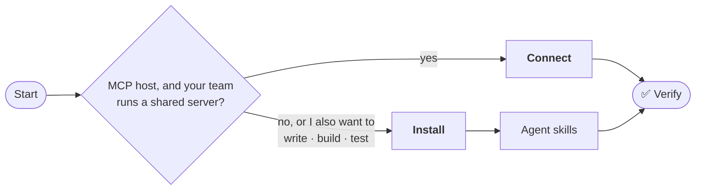

<sub>[README](../README.md) › [Docs](README.md) › Quick start</sub>

# 🚀 Quick start

Two different jobs share this page. Pick yours — each path is self-contained.

| Your situation | Path | Effort |
|---|---|---|
| You are setting up your own D365FO VM or machine — **the usual case** | [**Install**](#install-on-your-machine) | 10 min, plus the index extract |
| Your team already runs a shared server and your editor speaks MCP | [**Connect**](#connect-to-a-shared-server) | ~2 min |

> [!NOTE]
> Deploying the shared server for your team is a separate job, for whoever administers it:
> [SETUP_AZURE.md](SETUP_AZURE.md).



---

## Connect to a shared server

You need the server URL from whoever deployed it, and an API key if that deployment enforces one.
With `d365fo` installed (step 2 below), it writes the editor's configuration after checking that the
server answers, and leaves your other MCP servers alone:

```powershell
d365fo connect https://your-server.azurewebsites.net --editor vscode   # or claude; --api-key <key>
```

By hand, the entry is the URL ending in `/mcp`, with the key as an `X-Api-Key` header —
[MCP_CONFIG.md](MCP_CONFIG.md).

> [!NOTE]
> A shared server searches and reads the index it was deployed with. It cannot see your local
> changes or write to your VM; for that, install locally.

---

## Install on your machine

### 1. Prerequisites

| Requirement | Where to get it | Needed for |
|---|---|---|
| Node.js 18 or later | [nodejs.org](https://nodejs.org) | installing with npm |
| A `PackagesLocalDirectory` | a D365FO development VM, a share, or a copy of the package tree | the index |
| Visual Studio 2026 (or 2022 ≥ 17.14) | Visual Studio Installer | Copilot, and `build` / `sync` / `test` on Windows |
| .NET Framework 4.8 | already on D365FO VMs | the metadata bridge (writes into models) |

No .NET SDK is needed: the packages carry self-contained binaries.

### 2. Install

```powershell
npm install -g @dynamics365ninja/d365fo-cli
d365fo version
```

Without npm: a [release archive](RELEASING.md#installing-a-specific-release) or the
[source installer](SETUP.md#one-line-install).

### 3. Configure

```powershell
d365fo init
```

In a terminal this is a short wizard: it finds `PackagesLocalDirectory` (or asks for it), an optional
second root for UDE, your label languages, and saves the answers to
`%LOCALAPPDATA%\d365fo-cli\settings.json`. Unattended:

```powershell
d365fo init --packages K:\AosService\PackagesLocalDirectory --persist-profile
```

To let `d365fo` write into your models, enable the bridge once and open a new shell:

```powershell
[Environment]::SetEnvironmentVariable('D365FO_BRIDGE_ENABLED', '1', 'User')
```

### 4. Build the index

```powershell
d365fo index extract
d365fo doctor
```

The extract is the only slow step. On the development VM this repository is built against it covers
203 models — 18 467 tables, 60 927 classes, 525 714 methods, 1 420 121 labels — in a 750 MB SQLite
file that answers in milliseconds. To try things out first, extract one model:

```powershell
d365fo index extract --model ApplicationSuite     # or your own model, which takes seconds
```

### 5. Give your agent the skills

```powershell
d365fo skills install K:\repos\MySolution --for copilot    # the folder holding your .sln
d365fo skills install K:\repos\MySolution --for claude
```

The skills teach the agent which commands to run and the X++ rules behind them. Commit the
`.github/` or `.claude/` folder so your teammates get them too. Where each agent looks, in detail:
[SETUP.md](SETUP.md#step-5--connect-your-ai-agent).

---

## Verify

Restart the editor, open the AI chat in agent mode, and ask:

```
What tables contain the CustAccount field?
```

A `d365fo search` call returning results from **your** metadata — including ISV models no training
data has ever seen — is the signal that grounding works.

From a shell, the same ground:

```powershell
d365fo get table CustTable --output json
d365fo find coc CustTable::validateWrite
d365fo prepare change CustTable --goal "add a fleet reference field"
```

`prepare` is the one worth learning first: it answers "what am I about to change, what already
extends it, and which strategy applies" in one call, and hands back the **grounding token** that
`generate` asks for.

---

## Keeping it current

```powershell
d365fo update                                         # latest release; --check only looks
d365fo skills install K:\repos\MySolution --for all   # refresh the skills afterwards
d365fo index refresh                                  # after your metadata changes
```

---

## Next steps

| Topic | Documentation |
|---|---|
| Every install path and pitfall | [SETUP.md](SETUP.md) |
| Everything the tool can do | [CAPABILITIES.md](CAPABILITIES.md) |
| Whole tasks, end to end | [USAGE_EXAMPLES.md](USAGE_EXAMPLES.md) |
| One example per command | [EXAMPLES.md](EXAMPLES.md) |
| Every setting and environment variable | [CONFIGURATION.md](CONFIGURATION.md) |
| Something is wrong | [TROUBLESHOOTING.md](TROUBLESHOOTING.md) |
