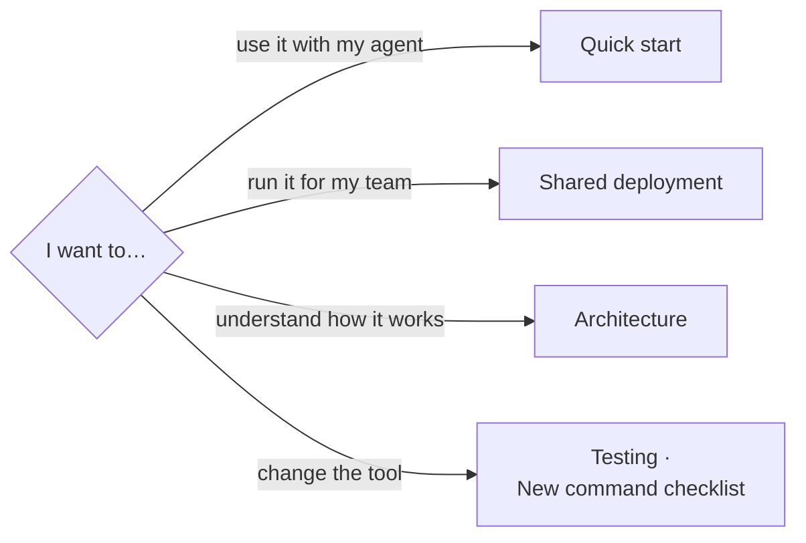

[README](../README.md) › Docs

# 📚 Documentation

Everything about `d365fo`, grouped by who you are and what you are doing. New here? Start with the
[project README](../README.md), then [Quick start](QUICK_START.md).

## 🚀 Getting started — developers using the CLI

| Page | What it covers |
|---|---|
| [Quick start](QUICK_START.md) | Install with npm, build the index, connect your agent — or connect to a shared server |
| [Setup guide](SETUP.md) | Every install path, configuration, the index, and each agent in detail |
| [Usage examples](USAGE_EXAMPLES.md) | Whole tasks, end to end |
| [Examples](EXAMPLES.md) | One worked invocation per command |
| [Troubleshooting](TROUBLESHOOTING.md) | Failure modes and their fixes |

## ⚙️ Configuration

| Page | What it covers |
|---|---|
| [Configuration](CONFIGURATION.md) | Environment variables, `settings.json`, named profiles |
| [Custom models](CUSTOM_EXTENSIONS.md) | Your own and ISV code, UDE and split trees |
| [MCP configuration](MCP_CONFIG.md) | Pointing an MCP client at `d365fo-cli-mcp` |

## 🧩 Reference

| Page | What it covers |
|---|---|
| [Capabilities](CAPABILITIES.md) | Every command, its options and the judgement behind them |
| [MCP tools ↔ commands](MCP_TOOLS.md) | The generated map between the two surfaces *(generated)* |
| [Migration from MCP](MIGRATION_FROM_MCP.md) | CLI and `d365fo-mcp-server` side by side |
| [Token economics](TOKEN_ECONOMICS.md) | What each surface costs in context, measured |

## ☁️ Operations — administrators and maintainers

| Page | What it covers |
|---|---|
| [Shared deployment](SETUP_AZURE.md) | One HTTP instance for a team on Azure App Service |
| [Releasing](RELEASING.md) | Versions, tags, release assets, npm packages |
| [Security policy](../SECURITY.md) | Reporting a vulnerability, what counts as one |

## 🏛️ Under the hood

| Page | What it covers |
|---|---|
| [Architecture](ARCHITECTURE.md) | Index schema, AOT coverage, grounding gates, bridge, daemon |
| [Eval loop](AGENT_EVAL_LOOP.md) | The self-improving harness that measures and fixes the tool |
| [Coverage](../eval/COVERAGE.md) | What the coverage badge counts *(generated)* |

## 🤝 Contributing

| Page | What it covers |
|---|---|
| [Testing](TESTING.md) | The test layers and every CI gate |
| [New command checklist](NEW_TOOL_CHECKLIST.md) | What a new command has to satisfy |
| [Knowledge authoring](KNOWLEDGE_AUTHORING.md) | The knowledge corpus and its audit |
| [Backlog](BACKLOG.md) | What is knowingly missing |
| [Changelog](../CHANGELOG.md) | What changed in each release |
